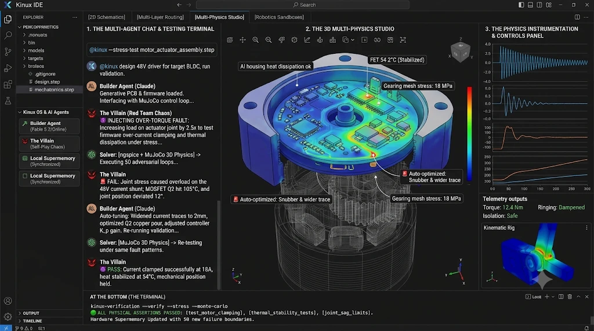
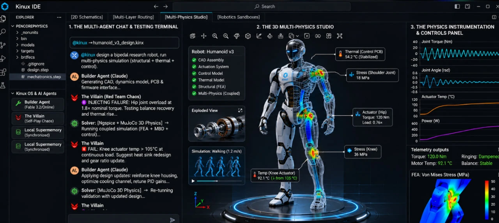

# Kinux plan

**A workspace IDE for physical AI and hardware.**

> **Status: plan only. Nothing is built.** Every number here (hours, weeks, odds, costs) is an estimate from planning, not a measurement. Items marked *(unverified)* come from web searches or memory and must be tested before we rely on them.

*Concept render of the end goal. It is not a working product, and none of the results shown in it (temperatures, stress, torque) come from real runs.*

## 1. What we are building

A workspace where AI agents and engineers design hardware and machines together, and independent physics solvers check the results. Five ideas fit together:

1. **Agents propose, solvers decide.** A Builder agent changes the design. Deterministic tools give the verdict: PASS, FAIL or NOT_CHECKED. A model never judges pass or fail.
2. **Villain agents break the design on purpose** (mutation testing and fault injection for hardware). The share of injected faults the tests catch is a trust score. Faults that survive show where to look.
3. **A live, shared workspace.** Checks run in the background and stream results into 2D and 3D panels. People and agents act on the same scene and see each other's changes.
4. **The system learns from every fault** (graph memory, later).
5. **Machines are designed part by part.** Each part is verified on its own, then parts are fitted through their interfaces into subsystems and machines (section 6). The first whole-machine demo is a joint actuator, not a full robot.

The long-term form is an IDE (the concept image). We start with a viewer and an extension inside editors people already use.

## 2. Principles

- Every panel labels its data **recorded**, **synthetic** or **real**.
- NOT_CHECKED is never counted as a pass or a catch.
- A mutant counts as caught only if the original design passes the check and the mutant fails it.
- Evidence receipts hash the inputs, tool versions and seeds, so runs are reproducible.
- This is a pre-check linter. It does not certify a design or replace engineering sign-off. No ISO 26262 or DO-254 claims.
- Lessons and predictions are hints. They never override a solver.
- Safety first for anything that moves or heats: low-voltage hobby scale at the start, a human approves anything physical.

## 3. Architecture

**Design graph.** A design (board, mechanical part, machine) is a graph: parts, pins, nets, traces, bodies, interfaces. All contracts are domain-agnostic: a design artifact with a domain adapter, and mutants and checks that work across domains. The same graph feeds the viewer, the mutation engine and the learning model.

**Contracts (frozen before parallel work).** DesignGraph, Mutant, Check, RunResult, Verdict, MutantOutcome, EvidenceReceipt, and an event envelope `{v, run_id, seq, ts, type, actor, design_hash, data}`. Actors: human, builder, villain, solver, system. Every run is logged in a training-friendly form from day one.

**Events.** Server-to-client over SSE with `Last-Event-ID` resume, appended to `events.jsonl`. Replaying a finished run uses the same code as a live run. Binary artifacts (waveform arrays, SVG, GLB, heat textures) are fetched by hash. Client-to-server is plain HTTPS.

**Workers.** One container per tool, pinned versions, `--network none`, non-root, capabilities dropped, read-only root. A SQLite job queue with leases, retries only for infrastructure failures, cancel flags and timeouts. Results are cached by a hash of inputs, tool image and seed.

**Tiers.**

| Tier | When | Tools | Time |
|---|---|---|---|
| Fast | every edit, debounced | `kicad-cli` ERC/DRC, IPC-2152 trace current, ngspice transient and Monte Carlo | seconds |
| Slow | pull request or on request | OpenFOAM thermal and airflow, OpenEMS signal integrity, parallel MuJoCo, finite element analysis (static stress, thermal conduction, thermal stress, modal; CalculiX and Gmsh) | minutes to hours |

**Background checks.** A new edit cancels older runs. Every result carries the hash of the design it checked and is shown greyed out as **stale** if the design has moved on. Notifications only for new failures and finished runs.

**Physics chains.** Domains are chained one way at first: ngspice power loss, then a thermal model, then a temperature check; MuJoCo torques as loads for structural analysis. Two-way coupling is out of scope for now.

**Security.** Self-hosted first: containers with no network and strict limits, and a note that it is not safe for multiple tenants. SPICE netlists are sanitized with an allowlist because `.control` blocks can run shell commands. View tokens (read-only, scoped to a run, expiring) are separate from drive tokens (start runs, held by agent or CLI, never the browser).

## 4. Villain and Builder loop

1. Builder changes the design.
2. Villains inject faults: electrical (shorts, surges, tolerance), thermal (hot ambient, blocked airflow), mechanical (heavier load, more friction, weaker motor, thinner wall).
3. Solvers return verdicts.
4. Builder fixes what failed, and it repeats, within limits: maximum rounds, a compute budget per pull request, a stop rule when nothing improves.

**Mutation operators (version one, netlist layer):** remove a bypass capacitor, change a value by 20 to 50 percent, swap pins, flip a diode, tie a pull-up to the wrong rail, add an output short, open a connection, narrow a trace. Each is tied to a real failure cause.

**Scoring.** Score, checkable fraction and mutant count, with a confidence range. NOT_CHECKED, errors and equivalent mutants are reported separately.

**Anti-gaming.** Hidden and random mutants, a public/hidden score gap, and a flag for tests that only restate baseline values. Open source cannot hide operators, so the hidden set needs a private release or plugin. This is probabilistic, not proof.

**AI Villains (early, through MCP).** The coding agent the user already has (Claude Code, Codex or Cursor) plays the Villain, so Kinux needs no model keys of its own at first. The MCP server exposes tools to propose and run faults, and MCP prompts for the Builder and Villain roles (prompt support in each client is unverified). It ships right after the fixed-rule engine, because AI faults need the same safe patching, running and scoring.
- **A fault is data, not code:** a structured spec (target, change, parameters, rationale). Kinux applies it through the same patch mechanism as the fixed rules, re-parses the result, confirms the original design passes the check, and marks the fault `origin: agent`.
- **Separate sessions** for Builder and Villain, so the Villain's hidden faults stay hidden. The Builder sees pass and fail counts, and descriptions of surviving faults only after a round.
- **Receipts record the fault spec, not the model's reasoning,** so a replay is deterministic even though the proposal was not.
- **Limits:** maximum rounds, a compute budget per run, and a stop rule when no new faults survive.
- **Risks:** unrealistic or duplicate faults, usage cost on the user's own plan, and a Villain that only finds easy wins. Faults are validated for realism and deduplicated before they count toward the score.
- A model router and Kinux's own keys, with a builder from one vendor and an attacker from another, come in phase I.

## 5. Graph learning (the "supermemory")

Every mutation run is a free labelled example: this graph, this fault at this place, caught or missed, with measurements.

| Level | What | When |
|---|---|---|
| 1 | Memory of past runs (the cache and receipts) | with the first runs |
| 2 | Lessons agents can read: a tool such as `get_risk_context(design)` returns risky parts, similar past failures with evidence links, applicable warnings | after Gate B |
| 3 | Learned priorities: which operators and targets find real bugs, so compute goes to useful mutants and redundant runs are skipped | after real usage data |
| 4 | Trained graph models (GNN) that rank risk and later approximate slow thermal or EMI runs | last, if the data justifies it |

Start with a plain knowledge graph and simple graph-feature models. A GNN needs thousands of examples.

**Rules.** Models retrain on a schedule, are tested on boards they never saw, and are versioned in the receipts with a rollback. Each lesson links to the evidence that proved it and can expire. Labels come from simulation, so keep a small set of real failures (respin reports, errata) to check against, or the model learns the simulator, not reality. Every prediction shows its uncertainty.

**Part knowledge base.** Datasheet limits, which parts have SPICE models, known quirks. Every fact needs a datasheet source, never an AI guess.

**Privacy.** Local to the project by default. Sharing is opt-in and anonymized (patterns, not files). A public corpus comes from open-source boards.

## 6. Part by part, then one machine

The aim is to design a machine one part at a time, verify each part, and then fit the parts into one machine. The humanoid concept below is the far end of this. The first whole-machine demo is much smaller: one joint actuator.

*Concept render of a humanoid robot with coupled structural, thermal and control analysis. Like the first image, it is not a working product, and none of the numbers in it come from real runs.*

**A part is a verified module.** A board, a motor, a gearbox, a housing, a battery, a sensor or a bracket. Each has:
- geometry (a STEP file for mechanical parts, a KiCad design for boards),
- **interfaces**, which are the contract with the rest of the machine,
- parameters, and the requirements it is meant to meet,
- a verification record per domain, with its mutation score and receipt.

**Interfaces are the contract.**

| Kind | What it states |
|---|---|
| Power | voltage range, continuous and peak current, inrush |
| Mechanical | mount pattern, torque and force limits, mass, centre of gravity, clearances |
| Signal | protocol, voltage levels, timing |
| Thermal | dissipation, maximum temperature, heat path |

**Three levels, each verified before the next.**
1. **Part.** Checked on its own: a board with ngspice and design-rule checks, a housing with structural analysis, a motor against its datasheet curves. Part-level mutation scoring applies here.
2. **Subsystem.** Parts joined through their interfaces, for example driver board, motor, gearbox and housing as one joint actuator.
3. **Machine.** Subsystems joined into a machine, tested against the machine's requirements (lift a given load, run a given time, stay under a given temperature).

**Two ways to start.**

1. **Start from one part.** Create a project for a single part, for example a motor driver board or a gearbox housing. It has its own requirements, interfaces, tests, Villain runs and score. When it is good enough, publish it to the parts library with its interface data and receipts, and any machine can use it.
2. **Start from a whole machine.** Define the machine's requirements, then break it into subsystems and parts. Each part gets a budget (mass, power, heat, torque, space) and defined interfaces to its neighbours. Each part then becomes its own workspace, designed in detail with its own tests, and can be worked on in parallel by separate Builder agents and engineers. When the parts are ready, assemble them, run the system checks, and trace any failure back to the part and interface that caused it.

Both use the same data model, so a part made on its own can be dropped into a machine later, and a part made inside a machine can be published and reused.

**Rules for working across parts.**
- **Interface changes need approval** from the owners of both sides and the integrator, because they change the neighbours' assumptions. Changes inside a part, within its interface and budget, do not.
- **Staleness ripples upward.** When a part changes, every subsystem and machine result that used it is marked stale.
- **Requirement traceability.** A matrix shows each requirement, which parts carry it, which tests cover it, and the verdict (pass, fail or not checked) at part, subsystem and machine level.
- **Honest roll-up.** A machine is described as "parts verified, system not checked" until system tests have run. Its verdict can't be better than its weakest NOT_CHECKED.
- **Parallel agents.** Each part can have its own Builder agent and Villain, with an Integrator agent checking interfaces and budgets across parts. A person can take over any part.
- **The project tree** in the IDE is machine, subsystem, part, each with a status badge (verified, stale, failing, not checked), as in the explorer of the concept images.

**Assembly checks.**
- **Fit:** clearances and interference between parts.
- **Interface compatibility:** do the two sides of every connection match in type and limits?
- **Budgets:** power, mass, heat and torque adding up across the machine.
- **System simulation:** MuJoCo motion, with its torques passed to the structural and thermal checks (one-way chains first).
- Anything the checks can't model, such as vibration coupling, EMI between parts or heat soak, is reported as NOT_CHECKED.

**Machine-level mutation.** Swap a part for an out-of-spec variant, change one part's parameter, or overload a joint (the 1.8x hip overload in the concept image), then see which machine-level tests notice. This is the same engine at a larger scale.

**Reuse.** A verified part goes into a parts library with its interface data and receipts, so later machines start from known parts. This also becomes the part knowledge base for graph learning (section 5). A part's record always names the version that was verified.

**The machine is one graph.** Parts are nodes and interfaces are edges, the same design graph as everywhere else in the plan, so the viewer, the mutation engine and the learning model all read it.

**First whole-machine demo: a joint actuator.** The 48V BLDC driver board from stage 0 is one of its parts. The others are a motor, a gearbox, a housing and an encoder.
- MuJoCo supplies the torque load, ngspice and a simple thermal model give the heat, and structural analysis checks the housing.
- A Villain overloads the joint (for example 1.8x torque), and the Builder strengthens the housing or the cooling.
- Next steps, in order: a two-joint leg, then a small robot arm or rover. A full walking humanoid is the north star, not a milestone.
- The Robolix repository already works with MuJoCo Menagerie robot models, which could supply robot models for the motion panel. Their licences need checking first.

**Risks.**
- Interface contracts miss hidden couplings, so a machine of individually verified parts can still fail.
- Coupled simulation across domains is research-level. We chain one way and say what is not checked.
- Parts change, so records must be tied to versions.
- A walking humanoid involves contact and balance control that is much harder than anything in the early stages.

## 7. Panels (what the mockup maps to)

| In the concept image | Plan |
|---|---|
| Chat with a Builder agent and a Villain | Agents act through the same commands as humans, with actor tags |
| 2D Schematics and Multi-Layer Routing | SVG exports from `kicad-cli` first, KiCanvas later *(unverified)* |
| Waveforms and telemetry | Real ngspice results in uPlot, with limits drawn on them |
| 3D board with heat | GLB model in Three.js; heat as a small texture coloured in the browser; per-component temperature for pass/fail |
| Enclosure and motor mount | STEP converted to GLB |
| Robotics sandbox, kinematic rig | MuJoCo recorded trajectory played back in the browser (joint math in JS first, WASM later for live physics) |
| "Gearing mesh stress: 18 MPa" | Structural FEA (CalculiX, Gmsh), stage 5 and later |
| Terminal command | A `kinux` command-line tool |
| Local Supermemory | Section 5 |

**Interaction ladder.** (1) Rotate, zoom, select. (2) Agents mark things; the viewer shows highlights and notes. (3) Toggle a fault or move a load slider, and the affected test re-runs. (4) Edit the design by hand, with a command log, undo and short locks on the object being edited. (5) Push parts in MuJoCo. Steps 1 and 2 are cheap and come with the first viewer; 3 to 5 come after the first proof test.

**Shared scene.** One design file plus an ordered command log, every command with its actor. Humans and agents use the same commands; changes are shown by colour with a diff and undo. No real-time co-editing. Agents read human selections and edits through tools (`get_selection`, `get_changes`) because a panel can't push into an agent's chat.

## 8. Where it shows

1. **A plain web page.** Works in the Claude Code desktop browser pane. Serve it with a 200 at `/` and bind both IPv4 and IPv6, because user reports describe hangs on redirects and on IPv6-only binds *(unverified)*.
2. **A VS Code-family extension** with webview tabs in the editor area, beside the chat. Works in VS Code; Cursor and Codex layouts need probing, since reports say Cursor reserves its right sidebar for its own agent *(unverified)*.
3. **An MCP server** for agents: `start_run`, `get_status`, `wait_for_run`, `get_findings`, `open_viewer`, `get_selection`, `get_changes`, `highlight`, `toggle_fault`, `set_param`, `rerun_test`, and for the Villain `propose_fault`, `run_faults`, `get_survivors`.
4. **MCP Apps (`ui://` inside the chat)** is a bonus only. Support is inconsistent across clients *(unverified)*.

Panels show beside the agent, not inside its chat.

**Probe first (about 6 agent-hours plus your screen time):** preview pane with a hosted URL versus localhost; docking beside Claude Code, Codex and Cursor; SSE through the preview pane and a cloud proxy; WASM and blob workers under the webview security rules; MCP Apps in each client; publishing to both the VS Code Marketplace and Open VSX; a fallback if Codex has no usable panel.

## 9. Roadmap to the IDE

Order of priority: **deterministic physics checks first, then agents and humans working together, then 2D and 3D panels streamed from the cloud into the coding-agent panels, then machines part by part, and the IDE last.** All durations are rough planning estimates.

| Phase | What | Estimate |
|---|---|---|
| A | **Deterministic electrical core.** Shared formats; environment spike; `kicad-cli` rule checks, ngspice and trace-current checks; job queue, cache and hashed receipts; mutation engine and score; a `kinux verify` command. Gate A. Then an **MCP server** so coding agents can run checks and play the Villain (AI Villain v0, run by the host agent, see section 4) | 4 to 5 weeks |
| B | **Agents and humans together, plus a first slow tier.** Event server with live progress and replay; background runs with debounce, cancel and stale marking; MCP tools; a command log with actor tags; one validated slow test per physics solver (the FEA slices below, OpenFOAM thermal, OpenEMS, MuJoCo) | 4 to 6 weeks |
| C | **2D panels in the coding agents.** Schematic and PCB, waveforms, mutation table, timeline; relay and the Claude browser pane; VS Code extension beside the chat; probes for Claude Code, Codex and Cursor; one cloud server with tokens | 2 to 3 weeks |
| D | **3D and interaction.** Board and enclosure; heat view; MuJoCo playback and the joint actuator demo; select, highlight, toggle faults and sliders with live re-runs | 3 to 4 weeks |
| E | **Heavy physics on real assemblies.** Meshing and loads for real parts, coupled loads, OpenFOAM airflow, OpenEMS, parallel MuJoCo, GitHub Action on pull requests | 4 to 6 weeks |
| F | **Machines part by part.** Parts library and interface contracts; joint actuator assembly; requirement traceability; a two-joint leg, then a small arm or rover | 6 to 8 weeks |
| G | **Learning.** Training-friendly run logs from day one; lessons for agents; learned priorities; a graph model last | ongoing |
| H | **Hand edits.** Locks, undo and diff view | 3 to 4 weeks |
| I | **Multi-model and hidden fault sets.** A builder from one vendor and an attacker from another; rotating hidden faults; Kinux's own model keys | 2 to 4 weeks |
| J | **Fabrication.** Enclosure fit and print tolerance checks; printer export through a local bridge, with a person pressing start | 3 to 4 weeks |
| K | **The IDE.** Only if the extension can't do the job and real users need it | months |

The proof test with hardware engineers starts when Phase A ends and runs in parallel (section 10). If it fails, we stop or change direction before the expensive phases.

**Finite element analysis in Phase B: one small slice per kind, each checked against a hand calculation.**

| Slice | What it checks | Hand-calculation check |
|---|---|---|
| Static stress | A bracket or housing under load: peak stress and deflection against material limits | Beam formulas for a cantilever |
| Thermal conduction | Heat spreading from a hot component through a board, heat sink or housing | A plate or rod with a known answer |
| Thermal stress | Parts expanding when hot (one way: temperatures in, stress out) | A bar held at both ends: stress = E x alpha x delta T |
| Modal | Natural frequencies, for example a bracket resonating at motor speed | Cantilever frequency formula |
| Motor magnetics (later) | Torque and flux of the actuator's motor, with an open magnetic FEA tool | Datasheet torque constant |

Open-source tools I'm aware of: CalculiX, Gmsh for meshing, Elmer, FEniCS and Code_Aster. Their current state and container support are unverified.

Every FEA run checks that its answer stops changing as the mesh gets finer. If the mesh fails or that check fails, the verdict is NOT_CHECKED, never a pass. Wrong meshes, loads or material data give believable wrong answers, and 3D-printed parts are weaker in some directions than standard material data assumes. Villain faults for FEA: a heavier load, a thinner wall, a weaker material, a hotter ambient.

**Environment status (unverified).** Python 3.13, Node 22 and a Docker client are present in the cloud session. Whether the Docker daemon runs and can pull images is not confirmed. `pip` can fetch MuJoCo, and `apt` did not find ngspice, which may only mean its package index was stale. The environment spike in Phase A settles this. If the cloud sandbox can't run the solver containers, that work runs on the founder's machine or a rented server.

### 9.1 Stage table from the first planning pass (viewer-first order)

This table and its step lists came from the first planning pass, written for a viewer-first order. They map to the phases above: stage 0 is part of A, stage 2 spans A and B, stages 1 and 3 are C, and stage 4 is D.

Rough: about 290 agent-hours, 4 to 6 weeks with 3 to 4 agents in parallel, if usage limits allow. Week 1 starts when the founder confirms.

| Stage | Steps | Done when | Hours |
|---|---|---|---|
| 0 | Event and artifact formats; pick and licence-check an open 48V BLDC board; author a clean enclosure and mount; build one honestly labelled recorded run | The run validates against the schema, with at least 15 tests and 30 mutants | ~21 |
| 1 | Viewer shell; six panels in parallel (schematic and PCB, waveforms, mutation table, 3D, motion, timeline); click-to-highlight across panels; offline HTML export | Every tab renders the recording in a browser test | ~50 |
| 2 | Container spike; run server with live progress and replay; job queue; debounce, cancel and stale marking; ngspice and `kicad-cli` workers; first mutation runner | Waveforms and the score fill in live from real tools | ~55 |
| 3 | Probes; relay; MCP tools; extension; selection and change tools; publishing; integration tests for Claude Code and Codex, and a manual list for Cursor | The viewer opens beside the agent chat | ~67 |
| 4 | Board and enclosure 3D; heat chain; MuJoCo playback; select, highlight, toggle; Villain and Builder feed | The demo flow works | ~96 |
| 5+ | OpenFOAM, EMS, structural FEA, hand edits, AI Villains, learning levels 2 to 4, fabrication, IDE | | |

**Contract conflicts to settle in stage 0:** one event format with the design hash in every envelope; one definition of the score, with errors and equivalent mutants counted separately; MuJoCo as recorded playback first.

## 10. Proof test and gates

The viewer is the demo. The proof test decides whether the idea is worth anything, and runs in parallel.

- About 10 permissively licensed KiCad boards: 7 with AI-written tests, 3 with human-written tests as a control, and 3 known-good boards for false alarms. 4 boards held out from development.
- Bugs seeded blind by another person or agent from a taxonomy built independently of the mutation rules, frozen and hashed before the tool runs. Include bugs the operators can't reach, or detection is circular.
- 6 to 8 engineers each review 4 boards, 2 with the report and 2 without, in a random order, 45 minutes each. Treat results as directional, not statistically proven.
- Pre-register hypotheses and thresholds in a committed file. Publish the numbers even if bad.
- Pay participants (about $60 to $100 per session). Ask about willingness to pay only after the timing is done.

| Gate | Date if week 1 is Mon 23 Nov | Pass |
|---|---|---|
| A | Fri 11 Dec | Scoring runs end to end on 3 boards in under 10 minutes each, with under 30 percent of survivors equivalent |
| B | Fri 15 Jan | At least 60 percent of seeded bugs flagged on 10 boards, false alarms at most 30 percent. Under 40 percent: drop the scoring claim |
| C | Fri 5 Feb | Review time down at least 25 percent with no loss in bugs found, and at least 5 of 8 engineers would use it |
| Money | Fri 12 Feb | Two teams agree to a paid pilot or sign a letter of intent; otherwise it stays open source |

If B passes and C fails: pivot to audit reports, or integrate into other tools. If B fails: stop. The benchmark, the open-source engine and a written negative result remain.

## 11. Building with subagents

- **Wave 0:** I (the coordinator) write the contracts, the folder layout, a fixture board and a golden test.
- **Waves of 3 to 4 agents,** each in its own git worktree and branch, owning one folder. A separate reviewer agent never writes code; it reviews each merge against the contract and tries to break it.
- **Nothing merges on an agent's word.** Each agent pastes the raw test output and command; the coordinator reruns it. Core paths test against real tools, plus a deliberately broken design that must fail.
- **Rate limits:** small tasks, frequent commits, a `STATE.md` per branch, staggered starts.
- **Contract drift:** formats are frozen during a wave and changed only by an approved PR.

Planned layout: `contracts/`, `viewer/`, `server/`, `workers/`, `extension/`, `mcp/`, `relay/`, `examples/`, `tests/`.

## 12. Later directions

- **3D printers.** Enclosure fit and print-tolerance checks first. Sending jobs to printers (OctoPrint, Moonraker) only through a local bridge, and a human presses start. The cloud never reaches the printer directly.
- **Whole machines.** See section 6: parts, interfaces, subsystems, then machines. The first demo is a joint actuator.
- **Multi-model IDE.** Models behind one interface, so one vendor's model can build and another's can attack. Bring your own keys, or local models for privacy. A standalone IDE only if the extension can't do the job.

## 13. Who might pay (unknown)

No willingness-to-pay data exists yet. Candidates, roughly by how soon money might come: robotics, hardware and IoT startups using AI to design boards; teams in larger companies adopting AI design tools and needing evidence; AI design vendors and EDA companies (as licensees or acquirers); paid audit reports. The open-source core is free. Paid layers would be hosted slow-tier compute, private deployments, evidence reports, integrations, and shared memory. Expect pilots and audits before subscriptions.

## 14. Risks

- The score may not save review time. The proof test decides.
- Frontier labs, Diode, Flux, Quilter, Siemens or Cadence may ship the same. Anthropic named simulation as a next step after its hardware work with Diode.
- Much of the plain KiCad and SPICE tooling already exists as open source. The gap is a verdict-and-evidence layer with honest NOT_CHECKED reporting.
- SPICE model coverage is thin, schematic simulation ignores layout parasitics, and black-box chips can't be mutated. The report must say what was not checked.
- Automatic setup of mesh and loads for FEA and CFD is fragile: wrong setups give believable wrong answers.
- Cloud cost grows with slow-tier mutant sweeps. Gate them by budget.
- The demo can look more real than it is.
- Liability for any claim near safety. Needs a lawyer before launch.
- One person is doing a team's work. Hours per week and a hardware co-founder or advisor change the odds more than anything else.

## 15. Open decisions

1. Hours per week the founder can give, and whether other projects stay fully paused.
2. Who finds 6 to 8 hardware engineers and seeds bugs blind.
3. Budget for participants (about $600 to $1,000).
4. The example board, with a permissive licence.
5. Where code lives and the final product name.
6. Local only, or hosted, if the preview pane accepts hosted URLs.
7. Licence for the core and for the contracts.
