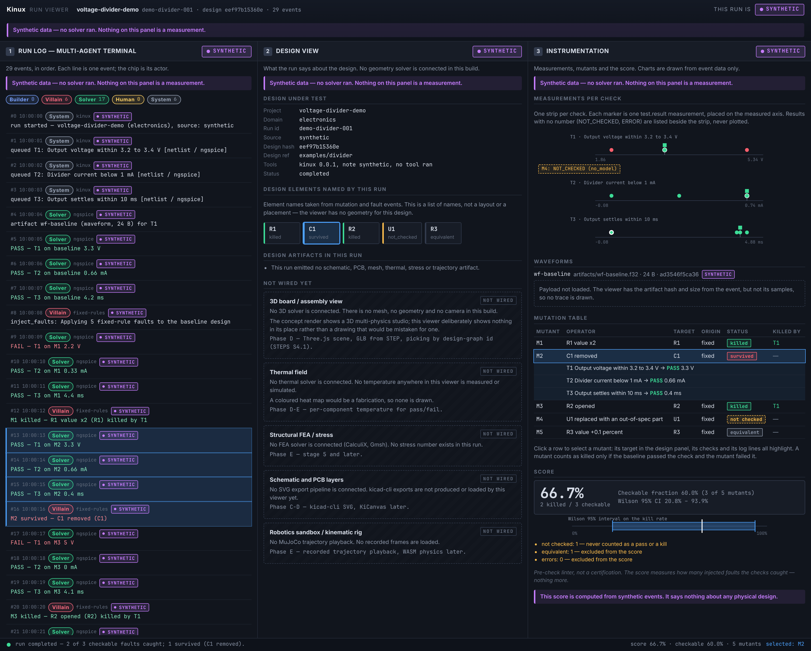

# Kinux viewer

The three-panel run viewer. Plain ES modules, no build step, no npm packages,
no framework. Everything here is hand-written HTML, CSS and JS served as
static files.



## Run it

The viewer loads ES modules, so it needs an HTTP origin — `file://` blocks
module imports. Any static server over the **repo root** works:

```bash
cd /path/to/Kinux
python3 -m http.server 8080        # or: npx --yes serve . , or any static server
# then open http://localhost:8080/viewer/index.html
```

By default it replays `contracts/fixtures/valid-run.events.jsonl`, the
entirely synthetic sample run.

| URL | What it does |
|---|---|
| `viewer/index.html` | replay the contract fixture |
| `viewer/index.html?run=<url>` | replay any `events.jsonl` |
| `viewer/index.html?sse=<url>` | follow a live SSE stream of events |

Both sources go through the same reducer, so a replay and a live feed of the
same events end in an identical state. That is asserted in
`tests/viewer.test.mjs`.

### Static export (STEPS S1.4)

```bash
node viewer/export.mjs contracts/fixtures/valid-run.events.jsonl /tmp/run.html
```

One self-contained HTML file: CSS, the flattened module bundle and the events
are all inlined. It opens from `file://` with the network switched off and
stays interactive, including cross-panel selection. There is no build step in
the project, so `export.mjs` contains the whole 40-line flattener: it strips
the viewer's internal `import`/`export` lines and concatenates the modules in
dependency order.

## Files

| File | Role |
|---|---|
| `reducer.mjs` | Pure append-only reducer. Events in, view state out. No DOM, no imports. Holds the JSONL source, the SSE source, the provenance arithmetic, the score and the selection expansion. |
| `dom.mjs` | Small DOM helpers and the provenance badge / notice / placeholder widgets. |
| `panels/log.mjs` | Panel 1 — run log. |
| `panels/design.mjs` | Panel 2 — design view. |
| `panels/instruments.mjs` | Panel 3 — instrumentation, charts drawn by hand in inline SVG. |
| `app.mjs` | The shell: title bar, three panels, status bar, selection, bootstrap. |
| `export.mjs` | Node-side static export. |
| `index.html`, `style.css` | The page. |

## Provenance: the rule that never bends

`contracts/event.schema.json` requires `provenance` on every event
(`real`, `recorded` or `synthetic`) and `contracts/README.md` says the UI must
always show it. In this viewer:

* **Every panel header carries a badge**, plus the window title bar for the
  run as a whole. The badge is never hidden and never optional.
* A panel that is anything other than purely `real` also gets a sentence in
  plain words above its content ("Synthetic data — no solver ran. Nothing on
  this panel is a measurement.").
* **A mixed panel shows the weakest label it was fed, never the strongest.**
  `synthetic` < `recorded` < `real`. A panel fed one synthetic event and
  twenty real ones reads `SYNTHETIC (MIXED)`, with the counts in its tooltip.
* Each log line carries its own event's provenance, and each artifact carries
  the provenance of the event that announced it.
* The score card repeats the warning: a score computed from synthetic events
  says nothing about any physical design.

The sample run is entirely synthetic, so every badge in the screenshot above
reads SYNTHETIC. That is the correct rendering, not a placeholder.

## What is live and what is a placeholder

**Live — driven entirely by events, nothing invented:**

* Panel 1, the whole ordered event stream as a conversation between
  `builder`, `villain`, `solver`, `human` and `system`, each with its chip.
  Every line's text is derived from that event's own fields.
* Panel 2, the design identity (project, domain, design hash, tool versions,
  run status), the design elements the run actually named in its mutation and
  fault events, the artifact inventory with hashes and sizes, and proposed
  faults with their on/off state.
* Panel 3, the measurement strips (one per check, one marker per
  `test.result` that carried a number), the mutation table
  (operator, target, origin, status, `killed_by`), and the score with its
  checkable fraction and Wilson 95% interval, drawn as inline SVG by hand.
* Cross-panel selection (S1.3): clicking a mutant, a design element or a log
  line highlights the mutant row, its checks, its target element and its log
  lines at once.
* Consistency: the viewer recomputes the score from the `mutation.result`
  events and shows a loud mismatch box if the `run.score` event disagrees.
  Sequence gaps and foreign `run_id`s are reported, not hidden.

**Placeholders — labelled NOT WIRED, deliberately empty:**

| Placeholder | Why it is empty |
|---|---|
| 3D board / assembly view | No 3D solver is connected. No mesh, no geometry, no camera exist in this build. Phase D. |
| Thermal field | No thermal solver. A coloured heat map would be a fabrication, so none is drawn. Phase D–E. |
| Structural FEA / stress | No CalculiX or Gmsh. No stress number exists in any run yet. Phase E. |
| Schematic and PCB layers | No `kicad-cli` SVG export pipeline is loaded by the viewer yet. Phase C–D. |
| Robotics sandbox / kinematic rig | No MuJoCo trajectory playback, no recorded frames. Phase E. |
| Waveform traces | The viewer reads a `test.artifact` of kind `waveform` and shows its id, uri, size and hash, but it does not have the sample payload for the fixture, so it says so instead of drawing a curve. Give `mountEvents(root, events, { waveforms: { 'wf-baseline': Float32Array } })` real samples and it draws the trace. |

The concept render in `docs/PLAN.md` shows a 3D multi-physics studio with
temperatures and stresses on it. None of those numbers are real, and none of
them exist in this codebase. The centre panel shows nothing in their place on
purpose.

## NOT_CHECKED

`NOT_CHECKED` and `ERROR` are never rendered as a pass and never counted:

* they are never plotted as a point on a measurement strip — they are listed
  beside it as a dashed gap chip with their `reason_code`;
* a `not_checked` mutant is shown with a dashed amber status, never a kill;
* the score reads `2 killed / 3 checkable` for the fixture, not `/ 5`;
  `not_checked`, `equivalent` and `error` counts are reported separately,
  immediately under the score, each marked as excluded.

## Tests

```bash
node --test tests/viewer.test.mjs
```

18 tests: the reducer against the contract validators, JSONL vs SSE
equivalence, badge logic for synthetic / real / mixed runs, the browser
assertions for every badge, NOT_CHECKED handling, cross-panel selection, the
honest design panel, and the static export opening from `file://` with
Playwright offline and every non-`file:` request aborted.
